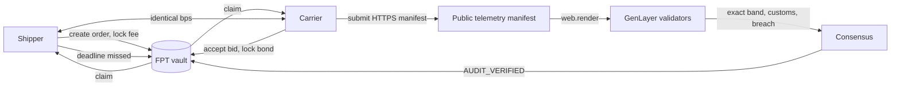

# FreightPulse architecture

FreightPulse separates three responsibilities:

1. **The GenLayer contract owns settlement.** It holds the FPT vault, the shipment state machine, the discrete fulfilment band and every balance mutation.
2. **Validators own the evidence judgment.** They fetch the carrier manifest independently, agree on a compact attestation and compare it with the deterministic manifest fields.
3. **The frontend owns presentation and wallet UX.** It previews the same pure helper, but it never decides a settlement and never writes without a signature.



## Shipment state machine

```text
OPEN
  accept_shipment_bid (carrier, bond locked)
CARRIER_ACCEPTED
  submit_delivery_manifest (carrier, before deadline)
MANIFEST_SUBMITTED
  audit_shipment_fulfilment_live
AUDIT_IN_PROGRESS
  consensus returns
AUDIT_VERIFIED
  claim_shipment_settlement
SETTLED

OPEN or CARRIER_ACCEPTED
  reclaim_expired_shipment (shipper, at or after deadline)
RECLAIMED
```

`AUDIT_IN_PROGRESS` is written before the non-deterministic block. It is a race lock: a second audit or a reclaim cannot interleave with the live fetch. Any failure reverts the whole transaction, including the lock.

## Settlement helper

`_compute_fulfilment_band` is the only place that turns telemetry into a band and a split. It receives fixed-point inputs:

- temperature in hundredths of a degree Celsius
- transit in minutes
- fee and bond in FPT base units

Returned fields include `fulfilment_band`, `carrier_fee_bps`, `carrier_payout`, `shipper_refund`, `bond_refund`, `slash_amount`, `escrowed` and `conservation_ok`. Every read view and every settlement write calls it. The audit calls it twice: once for the deterministic manifest values, once for the model attestation, and compares the outcomes.

| Band | Carrier | Shipper | Total |
| --- | --- | --- | --- |
| `FULL_ON_TIME_RELEASE` | fee + bond | 0 | fee + bond |
| `LATE_TRANSIT_PENALTY` | 70 percent fee + bond | 30 percent fee | fee + bond |
| `COLD_CHAIN_SPOILAGE_SLASH` | 0 | fee + bond | fee + bond |

## Manifest audit

The audit follows a strict sequence:

1. Snapshot the bill of lading, URL, temperature ceiling, transit SLA, fee and bond into locals.
2. Reserve the audit slot with `AUDIT_IN_PROGRESS`.
3. Inside `gl.nondet`:
   - render the URL with `gl.nondet.web.render(url, mode="text")`
   - strip control characters and cap the document at 12,000 characters
   - require the bill of lading to appear in the document
   - deterministically parse `Customs status`, `Peak cargo temperature` and `Transit time`
   - ask the model for one compact line: `CUSTOMS|TEMP|TRANSIT|BOL`
   - require the model outcome to match the deterministic outcome
   - compute the band from the deterministic values
4. Run `gl.eq_principle.prompt_comparative` with exact agreement on `fulfilment_band`, `customs_cleared` and `temp_breached`.
5. After consensus, re-run `_compute_fulfilment_band` on the agreed values and reject any mismatch before writing storage.

The model cannot change the settlement amount: it can only confirm or contradict the deterministic parse. A contradiction aborts the audit and leaves the shipment pending.

## Evidence trust boundary

The carrier chooses the manifest URL. The contract mitigates this with:

- HTTPS-only, public-host validation, no port, no embedded credentials
- bill of lading binding in the rendered document
- deterministic parsing of the three settlement fields
- independent validator fetches and a comparative principle
- a post-consensus deterministic re-check

It does not prove that the document is a legally authentic customs record. A production deployment would add a shipper-approved oracle allowlist or a multi-source attestation quorum. That would be a new contract version, not an admin override in this one.

## Mutual release

`propose_mutual_release` stores one bps value per party. A single signature returns `settled: false`. The transaction settles only when both flags are true and the stored bps values are identical. An outside caller is rejected. The bond returns to the carrier because both parties agreed to close without a breach finding.

## Timed reclaim

`reclaim_expired_shipment` is shipper-only and requires `now >= delivery_deadline_clock`.

- `OPEN`: refund the fee, no bond was locked.
- `CARRIER_ACCEPTED`: refund the fee and the forfeited bond.
- `MANIFEST_SUBMITTED`, `AUDIT_IN_PROGRESS`, `AUDIT_VERIFIED`: revert.
- `SETTLED`, `RECLAIMED`: revert.

The boundary is inclusive at the deadline. The direct suite tests both sides, and the live evidence records a real reclaim.

## Token and invariants

FPT is an internal settlement token with 6 decimals. `faucet_or_deposit` mints test balances with per-call and lifetime caps. `transfer_tokens` moves balances without changing supply.

`check_vault_invariants` proves:

- `vault_custody_balance == sum of locked escrow`
- `sum_token_balances + vault_custody_balance == total_supply`
- every settled shipment has `carrier_payout + shipper_refund == freight_fee + carrier_bond`

The frontend reads this view on first paint and displays PASS or FAIL. A failed invariant is a deployment incident, not a UI warning to hide.

## No privileged role

The contract has no owner field, no admin field, no steward method and no emergency withdrawal. The constructor takes no parameters. `get_governance_boundary` returns the complete list of settlement paths:

1. `audit_shipment_fulfilment_live` (validator consensus)
2. `propose_mutual_release` (identical shipper and carrier bps)
3. `reclaim_expired_shipment` (shipper, after a missed deadline, only when no timely manifest exists)

## Frontend read budget

The first paint performs exactly four RPC reads:

1. `list_shipments`
2. `check_vault_invariants`
3. `get_token_metadata`
4. `get_chain_clock`

No local ABI override is passed to `readContract`. Extra reads happen only on demand: wallet balance, faucet, and the explicit on-chain simulator verification. This keeps the studionet 30 requests per minute limit comfortable even when the page is opened repeatedly.

## Failure behavior

- A failed manifest fetch aborts the audit; the shipment stays `MANIFEST_SUBMITTED`.
- A missing or ambiguous model field raises a prefixed error and forces disagreement.
- A model outcome that differs from the deterministic manifest aborts the audit.
- A failed claim leaves the shipment `AUDIT_VERIFIED`; claims are permissionless, so any party can retry.
- A failed reclaim leaves the shipment unchanged; the shipper can retry after the deadline.
- The deployment script is resumable and paces every RPC call. A rate limit or connection reset is retried, never silently ignored.
